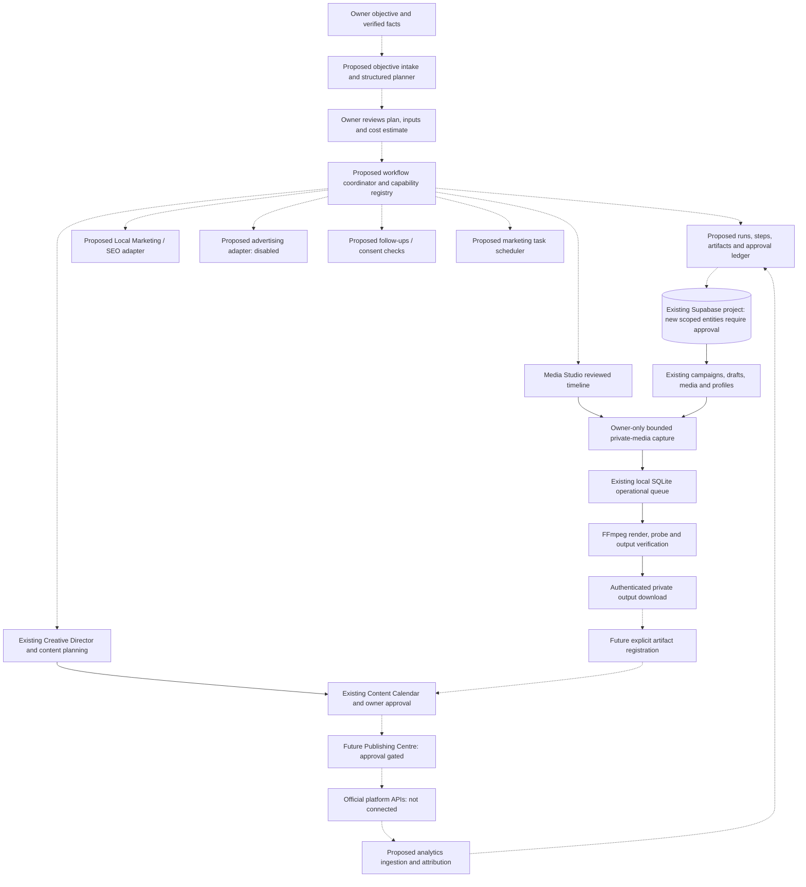

# COBS BUILDMASTERS LTD — marketing orchestrator and explainer-video architecture

Later milestone update: the free rule-based, owner-reviewed edit-plan generator and timeline handoff are now implemented and locally tested; see `AI_AUTOMATIC_EDITING_DIRECTOR_REPORT.md`. This does not implement the broader orchestration layer, semantic media analysis or paid AI planning. The architecture's earlier staged boundaries remain historical context. No production schema change is authorized by committing this document.

15 October 2026 · `develop/dashboard-media` · staged architecture and local development.

## Decision and current scope

Reuse the existing Next.js/TypeScript application, Supabase project, Creative Director, campaign/draft authorities, private Media Library, Media Studio queue and owner approval workflow. Do not create a duplicate app, parallel campaign database or another hosted project.

The centralized orchestrator described below is **proposed architecture, not an implemented durable workflow service**. This phase extends real Media Studio output with manually timed subtitles and adds an honest Settings integration-status view. It does not advertise simulated orchestration, semantic media analysis, platform integrations or unsupported editing controls as working.

The TikTok reference file/URL was not supplied. This design addresses the techniques and coordination requirements listed in the request; it does not claim to have analyzed the reference footage.

No production SQL, P2 execution, Auth/RLS/Storage changes, migration-history changes, paid service activation, customer messaging, advertising spend, commit, push, merge or deployment is authorized or performed.

## Architecture review: reusable foundations

| Component | Existing capability | Boundary / missing dependency |
|---|---|---|
| Authentication / P1 | Server-verified user and trusted owner profile; owner-only operations and RLS | Staff roles must not be inferred from ordinary authenticated access; P2 remains pending |
| Creative Director | Structured filming plans, storyboard, checklist, scripts, captions, calendars; labelled sample/manual mode; server-side OpenAI integration | No semantic image/video analysis or automated timeline compiler |
| Campaign Planner / Content Calendar | Campaigns, drafts, media selection, review and approval invalidation on edits | No durable workflow-run/step/artifact ledger |
| Media Library | Private authenticated original uploads/previews, allowed formats and deletion protections | No audio import policy, semantic tags, stored verified duration/probe registry or screenshot-redaction service |
| Media Studio | Manual timeline, clip editing, original-logo watermark, real combined photo/video MP4, four ratios including 9:16 | Hosted multi-asset saving proposal remains unapplied; advanced compositing/audio tracks/transitions pending |
| Local FFmpeg worker | Durable operational SQLite jobs, capture-before-queue, leases, idempotency, capped retries, private downloads and retention | Owner PC must stay awake; not distributed hosting or durable company-workflow storage |
| Leads | Existing lead-entry form | Consent-aware CRM, reminders and message transport planned |
| Analytics | Actual workspace counts and local render job states | No connected reach, engagement, ad conversion or sales attribution feed |
| Publishing / advertising / local SEO | Existing publishing-readiness UI and specifications | No verified Meta/TikTok/YouTube/Google/advertising connector |

Combined exports were already implemented and locally verified before this phase: up to 12 clips, 6 originals, 60 seconds, 50 MiB combined capture/output and hard cuts. Those limits remain in force. Hosted capture-to-download acceptance is still unverified; this design does not relabel local tests as hosted acceptance.

## Communication diagram

Solid rendering/data paths below reuse existing components. Dashed paths represent proposed orchestration/adapters; their presence is not an integration claim.

The coordinator does not receive unrestricted database/service-role access, shell access or platform credentials. It selects allowlisted component actions; each adapter rechecks owner permission, current input revision, policy and approval at execution time. Prompts and generated text cannot authorize actions.

## Proposed workflow contract

Each run stores objective text, owner/workspace, scope, source facts/provenance, campaign reference, plan revision, requested deliverables, resource budget and timestamps. Each step must expose:

| Field | Meaning / enforcement |
|---|---|
| Required inputs | Typed references to current campaign, media, scripts, selected facts and prior verified artifacts; missing input blocks execution |
| Assigned component | Allowlisted adapter/action/version, not free-form code or an AI-provided endpoint |
| Status | `blocked`, `ready`, `awaiting_owner`, `queued`, `running`, `retry_wait`, `failed`, `cancelled`, `verified`, `superseded` |
| Actual outputs | Artifact IDs with type, checksum, revision, provenance and verification result; a suggested filename is not an output |
| Error/blocker | Safe actionable category, retryability and next action; no credentials, signed URLs or private debug dumps |
| Resource estimate | Unit, range/value, source, timestamp, limits and uncertainty; unknown values are null with an explanation, never zero placeholders |
| Approval | Owner ID, action scope, approved input/output hashes, maximum cost and expiry; editing dependencies invalidates downstream approval |
| Next action | Allowed action derived from state, capability and approval; unavailable actions remain disabled with a specific blocker |

Runs distinguish **ready for owner review**, **completed within approved scope**, **failed** and **cancelled**. A run cannot complete until every required output passes its verifier and all required approvals exist. A successful API response, queue submission, placeholder preview, AI assertion or sample template cannot certify completion.

Dependency edges form an acyclic graph. Input changes mark downstream artifacts superseded and require fresh owner review; they do not rewrite approved artifacts. Stop/compensation is explicit: retries do not delete originals, undo customer messages or silently refund ad spend. Those effects require separate carefully designed handling.

## Example: 45-second factory promotion

Objective: “Create a 45-second block factory promotion using uploaded videos and photographs. Make Instagram and Facebook versions, add our original company logo, generate captions, and prepare everything for my final approval.”

| Step | Inputs / component | Verified deliverable / blocker | Approval and next action |
|---|---|---|---|
| 1. Confirm brief | Owner objective, verified company facts; proposed intake | Structured 45-second brief with intended placements; no invented stock, price, customers or certifications | Owner confirms facts and intended aspect/placement |
| 2. Select evidence | Real media IDs and permissions; Media Library | Selected original references, actual media types and verified timing metadata | Owner selects originals; missing/unknown durations block automatic trimming |
| 3. Propose scenes | Brief, media provenance, duration limits; Creative Director + future timeline compiler | Editable scene plan with source IDs, trim ranges, captions and provenance | Label manual/rule-based versus live AI; owner reviews unsupported techniques and clip order |
| 4. Review production | Timeline and actual supplied logo; Media Studio | Valid 45-second timeline using only supported operations | Owner approves rendering inputs and resource budget |
| 5. Render variants | Owner-selected aspects and reviewed snapshot; existing worker | Two real MP4 files within bounds; no pretend platform approval | Two separate explicit jobs; current default may capture the same originals twice and consumes two reservations |
| 6. Verify artifacts | Actual files; proposed verifier registry | Decode, dimensions, codec/audio, duration, hash and expected source sequence verified | Failed output blocks review; do not mark queued jobs complete |
| 7. Prepare review drafts | Actual registered media, captions and campaign; Content Calendar | Saved Draft references to verified artifacts with the correct revisions | Current registration is manual; automatic registration requires a reviewed adapter |
| 8. Owner final review | Both actual versions and captions; existing owner workflow | Approved revisions or returned drafts | Editing invalidates approval; no automatic publication follows |
| Optional publish | Approved artifacts + official connector + authorization | Currently blocked: publishing integration is not implemented/live-verified | Configure/verify connector in a separate approved phase |

45 seconds is within the current per-export limit, but the planner must also respect 12 clips, 6 originals, per-clip durations and source-size limits. Two variants do not automatically have verified platform compliance; official placement constraints must be checked when implementing the connector. The owner's example requests preparation for review, not permission to publish.

## Data model and migration boundary

Propose, do not create now:

- `cobs_marketing_workflows`: owner/workspace, campaign FK, objective, scope, plan revision and lifecycle.
- `cobs_workflow_steps`: workflow FK, allowlisted component/action, inputs, revision, state, lease, attempt count, schedule and safe error.
- `cobs_workflow_dependencies`: true step FKs with cycle prevention.
- `cobs_workflow_artifacts`: step FK, artifact/media/post references, type, checksum, provenance and verification version/result.
- `cobs_workflow_approvals`: owner, exact action/revision/hash, resource ceiling and expiry, linked to existing content approval semantics.
- `cobs_workflow_events`: append-only state/approval audit, privacy-conscious retention.
- `cobs_integration_connections`: provider/account/scope identifiers, capability status and last verified timestamps; secret material belongs in approved server-side secret storage, not browser-readable tables.
- `cobs_usage_reservations`: workflow/step, cost unit/ceiling/reservation and actual measurements for future distributed accounting.

Reuse `cobs_campaigns`, `cobs_posts`, `cobs_media_assets`, `cobs_profiles` and appropriately reviewed existing leads; do not duplicate business entities. Reuse the separately proposed Media Studio project/clip schema for durable timelines. RLS, appropriate role grants, true FKs, revision checks and deletion guards are mandatory before these entities are exposed.

Current SQLite jobs remain temporary render operations. Do not hide durable marketing workflows inside browser localStorage, unrelated lead fields or arbitrary post JSON with unprotected media references. Durable orchestration is blocked on reviewed persistence and separately approved production migrations. Inspect live schema/history, data dependencies, backups/recovery and exact rollback metadata before requesting production approval; do not run db push/reset/repair or register historical migrations automatically.

## Explainer production plan and feature stages

An AI-directed explainer plan should contain concept, hook, narration, scene order, selected visual references, caption cues, camera/zoom suggestions, transitions, music direction and branded ending. Proposed instructions must be editable and reviewed before compilation. Unsupported operations must be blocked or explicitly replaced with owner-approved supported alternatives; never silently omit a requested effect and call the render complete.

Text-only plans can use owner-supplied descriptions with the current server-side OpenAI adapter after cost approval, or labelled manual/sample planning. Rule-based mapping from selected media/order/timings is not semantic analysis. Vision, OCR and speech analysis require separate adapters, evidence/provenance, confidence/limitations, privacy review and explicit paid-provider approval if applicable. Media/EXIF/filenames cannot establish project completion or verified dates by themselves.

| Technique | Current status / next delivery gate |
|---|---|
| Multi-source MP4 and 9:16 | Implemented and locally tested; hosted capture/download acceptance pending |
| Screen recordings | Existing MP4/MOV import can accept supported owner-supplied recordings within bounds; no screen capture, automatic redaction, WebM or HDR compatibility promise |
| Screenshots/diagrams | Existing JPEG/PNG/WebP originals can become full-frame timeline clips; no semantic interpretation implied |
| Static logo/text | Existing real watermark/headline/subtitle render path |
| Timed subtitles | Next practical milestone delivered in this phase: manual per-clip cues, preview and real burn-in; test results recorded below |
| Branded lower-thirds / closing scenes | Later reviewed layout presets using original branding and actual owner-supplied text/media; no invented contact/offer details |
| Digital zoom/pan and keyframes | Next bounded rendering primitive after captions; numeric allowlisted keyframes, frame-based interpolation, browser/export parity tests and resource review |
| Multiple layers / PiP / dashboard overlays | Future layered schema with true media FKs, explicit time ranges, per-layer source capture limits, safe compositing and real export tests |
| Animated arrows/callouts | Future native bounded graphic primitives; no arbitrary SVG/scripts/filter expressions or generated replacement logo |
| Background music/voice-over | Future licensed audio import, storage-policy approval, consent/rights, mix/ducking/normalization and clipping tests; no paid TTS enabled |
| Smooth transitions | Future explicit overlap model, duration accounting, normalized video/audio crossfades and real frame/audio verification |

The current static original-logo overlay remains unmodified. A closing scene is not fabricated just because a plan mentions it; it must render from actual approved inputs.

## Integration-status view

Settings → **System Status & Integrations** is the existing entry point. This phase adds a module-status table for Creative Director, Content Planning, Media Studio, Social Publishing, Local Marketing/SEO, Advertising, Leads/Follow-ups, Analytics and Scheduled Tasks.

AI status is a server-side key-presence check, not a paid generation test or live credential validity proof. Worker status is an authenticated local heartbeat/capability check, not hosted render acceptance. Missing external connectors are marked not implemented; performance metrics are unavailable. Existing workspace counts/local job history remain actual internal data, not invented reach, sales or ROI.

Future status contract: `not_implemented`, `not_configured`, `configured_unverified`, `verified`, `degraded`, `revoked`, plus scope/account identifiers, evidence, checked timestamp and expiry. Verification requires an official API action with the necessary permissions and an observed response. Never infer a working integration from an API-key field, SDK installation or mock test.

Official connector planning must address Meta permissions/account/page linkage, TikTok supported publishing scopes, YouTube OAuth/upload review, Google Business Profile eligibility/access and Search Console read scopes, and separate advertising permissions/budget controls. Exact scopes, quotas, review requirements and current terms must be verified against official documentation immediately before implementation; none are provisioned now.

## Reliable execution and security

- Owner permission is checked at intake, dispatch, retry, download, approval and every side effect. Current authenticated non-owners remain denied. Do not weaken P1 or execute P2.
- Reserve bounded resources before dispatch; use step/revision/action idempotency keys, leases with compare-and-swap transitions, capped attempts/backoff, retryable error classes and explicit dead-letter review. Do not retry ambiguous publish/send/ad-create responses without provider-side reconciliation.
- Distinguish render approval, content approval, publishing authorization, customer-message consent and ad-budget approval. One never grants the others. Revoked/expired approval blocks queued side effects at execution time.
- Use a transactional outbox for future distributed dispatch; workflow events and step-state transitions must commit atomically. Verify output existence/hash/format before completing the step. A callback alone cannot certify success.
- Keep API/OAuth credentials server-side; use minimal scopes and audited secret storage. Workers receive short-lived scoped work, not unrestricted company access. Never persist bearer tokens or signed URLs in operational history.
- Treat objective text, uploaded screenshots, OCR, transcripts and AI outputs as untrusted content. They cannot issue tool commands or override policies. Validate structured output and all media references independently.
- Originals remain immutable; no automatic record deletion, Storage upsert, cleanup of company media or destructive compensation. Temporary worker retention remains explicitly documented.
- Screenshots/screen recordings may reveal credentials, addresses or customer information. Require owner confirmation/redaction before third-party analysis. No automatic third-party media analysis is enabled here.
- Consent-aware CRM and privacy/retention controls precede any customer communication. Do not automatically send messages. Metrics need provenance and clear estimates/incomplete attribution labels.

## Hosting and cost assessment

Current free/open-source components: existing Next.js app, Node worker, FFmpeg/ffprobe, operational SQLite and local tests. They require an available Windows PC, CPU, electricity and disk. Existing Supabase Free usage still has storage/egress/quota constraints; live usage/headroom was not checked in this phase.

Current bounds remain one active render, 12 clips, 6 sources, 60-second export, 50 MiB combined originals/output, 100 MiB intermediate budget, capped deadlines/retries and 24-hour temporary retention. Two variants can consume two source transfers/reservations. Local usage ceilings are not an account-wide billing lock or quota guarantee.

Durable marketing scheduling requires an always-on or scheduled worker and persistent workflow/outbox database. Do not run long FFmpeg jobs inside Vercel request functions or promise that a sleeping owner PC will execute scheduled jobs. Distributed rendering/queues, object lifecycle management and worker authentication need a new cost/security review; no hosting/subscription is purchased now.

Optional metered costs: live text/vision/speech/TTS APIs, hosted workers, additional storage/egress, communications providers and ad spend. Estimates must state assumptions and units rather than invented monthly prices or performance. No paid provider is activated. Obtain documented cost/budget approval before enabling any paid adapter.

## Implementation sequence and acceptance gates

1. **Preserve/verify real combined export.** Reuse existing actual output tests; retain hosted acceptance gap. No unnecessary repeated production fixtures.
2. **Timed-caption milestone (this phase).** Backward-compatible validated cues, clip-relative preview, split redistribution, capability checks, genuine FFmpeg burn-in and synthetic timing tests. No schema changes.
3. **Reviewed edit-plan compiler.** Define a typed plan schema with facts/media provenance, supported operation registry and static/manual/sample mode; compile only owner-approved plans into the existing timeline. Reject invented IDs, unknown durations, unsupported effects and over-limit plans. Do not call rule-based compilation semantic AI analysis.
4. **Durable workflow persistence.** Propose exact RLS/FK/revision/outbox schema, recovery and isolated tests; production application requires separate approval. No orchestration-complete claim before this gate.
5. **Coordinator and owner objective workspace.** Implement typed DAG execution and track inputs/component/status/outputs/blockers/resources/approval/next action, backed by real artifacts. Test restart, dependency invalidation, leases, output failures, duplicate requests and cancellation.
6. **Bounded explainer primitives.** Zoom/keyframes → branded layouts → layers/PiP → licensed audio → transitions, each with real export and resource tests before controls are advertised.
7. **Official connectors.** Separate approval for account authorization, platform review, live verification, messaging and spending. Begin read-only analytics before write/publish/ad actions where practical. Retain unavailable values when disconnected.

Acceptance must include: non-owner/anonymous denial; private media protection; no invented facts/media/metrics; invalid plans rejected; unchanged originals; real dimensions/duration/audio/captions; output verification before step completion; approval invalidation on edits; retries without duplicate side effects; preserved existing business records; no automatic publication/messages/spend; server-only credentials; honest local/mock/hosted reporting.

## This phase's implementation evidence

Timed-caption and integration-status results are recorded in `MEDIA_STUDIO_EXPLAINER_MILESTONE.md` after final checks. Earlier real combined-output evidence remains in `MEDIA_STUDIO_MULTI_EXPORT_VALIDATION.md`. Five business-growth module priorities remain in `COBS_AI_BUSINESS_GROWTH_ROADMAP.md`; no independent duplicates are introduced.

Current validation: 117 automated tests, all 7 browser tests, TypeScript, formatting and the standalone production build passed. Real synthetic frames confirm clip-relative subtitle presence/absence, including low-frame-rate video. Exact evidence and limits are recorded in the milestone report. The orchestrator itself remains proposed architecture.

Hosted verification, durable multi-asset saving, orchestration persistence, semantic media analysis, external publishing/ads/SEO/analytics and advanced editing techniques remain pending. Existing P2/security and migration-alignment issues remain in the security reports. Stop for owner review before any production change or commit/push.

Implementation reference: [FFmpeg timeline-enabled filters](https://ffmpeg.org/ffmpeg-filters.html#Timeline-editing) and [drawtext](https://ffmpeg.org/ffmpeg-filters.html#drawtext-1). These support the rendering design; they do not establish hosted integration verification.
