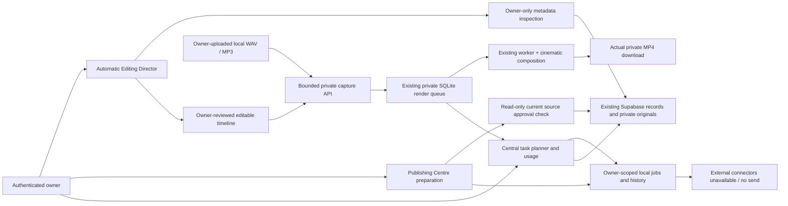

# Accelerated development status

Branch: `develop/dashboard-media`; baseline `a9e53f54a3b2de9f9c84e8bc4e726393eb2b158f`.

Subsequent milestone (2026-10-16): the existing renderer now also supports capability 5 for the **COBS — The Art of Building** grade, video speed and original-logo ending. The accelerated sprint work and its historical results below are retained. See [COBS_ART_OF_BUILDING_IMPLEMENTATION.md](COBS_ART_OF_BUILDING_IMPLEMENTATION.md) for the latest scope, exports, tests and limitations. No production changes or commit/push were performed.

## Internal checklist

- [x] Verify existing repository/branch and retain local VS Code settings.
- [x] Reuse original logo, existing renderer, owner APIs, Creative Director and timeline.
- [x] Sprint 1 local implementation: bounded cinematic model, separate local audio, real transitions/motion/templates/composition and real-output tests. Frame/layout preview updates; mixed audio and transition preview remain export-based.
- [x] Sprint 2 local implementation: metadata-based cinematic planning, explicit instruction hints and owner-feedback regeneration; rule-based versus genuine AI labelled. Focused model tests pass.
- [x] Sprint 3 local foundation: owner-gated publishing preparation, schedules, idempotent jobs and history; external publishing disabled. Focused ledger/API tests pass; browser verification underway.
- [x] Sprint 4 local foundation: central task dashboard, truthful metrics/contracts, campaign/storytelling/education/follow-up templates and measured local render usage. Owner-reported task evidence is not verified output.
- [x] Final full automated/browser/TypeScript/format/build verification; inspect exported examples and source integrity.
- [ ] Consolidated owner review. No commit/push without separate approval.

## Boundaries and blockers

No production Supabase changes, P2, migration-history operations, provider authorization, paid API calls, social publication, advertising spend, merge or deployment. Multi-asset cloud persistence remains blocked on the separately reviewed schema; its legacy caption validator still needs a reviewed amendment. Local operational jobs are not a substitute for durable cross-device company records.

Baseline capabilities: real six-source hard-cut exports, timed captions, original-audio volume/fades, original logo, manual timeline and rule-based automatic director. Missing advanced effects and external integrations will be recorded against actual results rather than advertised as complete.

## Costs

Local CPU/disk/electricity only for new local processing; existing Supabase reads consume existing project bandwidth. No billable AI/transcription/narration or external publishing is enabled. Provider metrics/costs remain unavailable unless measured by a configured integration.

## Implementation and verification in progress

- Existing legacy exports remain on recipe versions 2/3; cinematic exports require worker capability 4 and cannot be accepted by older workers.
- Version 4 supports hard cuts/crossfade/dissolve, original clip volume/fades, a looping music track and independent recorded narration, two linear motion keyframes, fade-in title placement templates and one muted picture-in-picture layer. Base footage + PiP + text/captions + unchanged original logo form the bounded composition. Source media remains untouched.
- Real six-source synthetic output checks passed: all intended segments, transition blend/dissolve pixels, changing motion positions, PiP pixels, title/caption visibility, logo pixel comparison, music/narration/original-audio tone measurements and fades, full decoding and source hashes. Final Chrome playback/regression results are pending.
- Local WAV/MP3 audio capture is owner-only, bounded to 10 MiB/file, 50 MiB/day and ten files/day. Handles and files expire after 24 hours; the local worker removes expired temporary audio. No Supabase audio policy/bucket modification is needed. Crash/interruption recovery and distributed throttling remain limited to this local deployment.
- Publishing preparations are immutable per platform-caption/source-revision key. Fresh source approval plus separate exact platform-copy review are required; source edits invalidate review. Readiness retries never call external providers. A manual public link is labelled owner-reported, never provider-verified. No schedule executes automatically.
- Local marketing tasks survive reloads/process restarts in the existing SQLite operational store. They reference campaigns, hold checklist steps and owner evidence/history. They do not replace Supabase business records, create real leads/campaigns or automatically execute the proposed orchestration architecture.
- No new dependencies, paid service activation, production SQL, P2, migration-history change, commit or push.

## Remaining integrations and explicit limits

Multi-asset/cinematic cloud project persistence and complete plan persistence require a separately approved schema. Cinematic saves fail closed instead of discarding unsupported fields. Optional visual AI, speech transcription and generated narration require provider selection, privacy/licensing and cost review, then explicit billable-call approval; none is connected. Existing server-side Creative Director AI remains separate and is not invoked by the new planner.

Publishing connectors/OAuth, provider-side schedules, background publishers, analytics ingestion, ad management and customer messaging remain unavailable. All external performance/cost metrics are null/unavailable. Local workflow counts and reserved render-input usage are measured and labelled. Production worker hosting, cross-device operational persistence, broad phone codec/orientation compatibility and arbitrary visual-layer/keyframe/easing editing remain incomplete. Only one secondary visual layer and two linear keyframes per clip are supported. Dissolve/fade and mixed-audio timing are verified in final output, not simulated as a frame-exact browser compositor.

## Reused architecture and data flow

No new Supabase project or production table is created. Existing business records are read through the original authenticated/RLS client; new operational rows are local SQLite only. The owner must approve source content in the existing Approvals workflow and separately review exact platform captions. Prepared jobs do not execute social publication.

## Acceptance evidence and limitations

| Area                          | Implemented behavior                                                                                                                                                                                | Verification scope                                                                                                                          |
| ----------------------------- | --------------------------------------------------------------------------------------------------------------------------------------------------------------------------------------------------- | ------------------------------------------------------------------------------------------------------------------------------------------- |
| Multi-source cinematic export | Six originals, two separate audio tracks, original audio/mute/volume/fades, transitions, linear motion, templates, captions/logo and one muted PiP                                                  | Actual FFmpeg export, pixel/tone measurements, source hashes and full Chrome playback; hosted private capture remains separately unverified |
| Cinematic preview             | Real source framing, motion, title placement/alpha, captions and PiP update in the existing player                                                                                                  | Changed-workflow browser tests; no claim of exact mixed-audio/transition preview                                                            |
| Planning intelligence         | Explicit supported instruction hints, verified metadata, priority order, duration allocation with transition handles, cinematic presets and feedback regeneration                                   | Pure model/API regressions; rule-based only, no visual understanding or billable AI                                                         |
| Publishing foundation         | Immutable per-platform preparation, local schedule intent, exact-copy review, idempotency, stale-source invalidation, three readiness retries, cancellation/history and owner-reported public links | Real isolated SQLite models and authenticated API tests; mocked hosted/browser services; zero platform API requests                         |
| Marketing operations          | Local task workflows, assigned components, owner evidence/history, workflow counts, campaign counts and local reserved render usage                                                                 | Local persistence/reopen and browser reload tests; provider performance metrics stay unavailable                                            |

Temporary audio is not stored in Supabase and cannot be recovered as a saved cloud timeline after reload; re-upload when its handle is lost/expired. Local schedules are not an active scheduler. Public-link recording discards tracking/credential query parameters (retaining a valid public YouTube video ID); use direct post-path links. Link reports are never claimed as verified publication.

Final review corrected a stale local review marker on direct readiness retry after a source edit; publication was already blocked by source-revision/approval checks. Focused tests now assert that both the state and review marker invalidate. Initial browser automation used an exact label selector that did not resolve a wrapped select despite the accessible combobox being present; the test now uses the rendered control role. No login failure or production regression was inferred from that timeout.

## Owner approvals still required

No approval is needed for the safe local edits/tests completed here. Separate explicit approval is still required for any production SQL/security/Auth/Storage/history change, external account OAuth authorization, billable AI/transcription/narration calls, live publishing/customer messages, advertising spend, production deployment, merge, commit or push. The next practical review is this tested local interface and the synthetic cinematic export, followed by a separately scoped persistence/recovery proposal if desired.

## Final verification

| Final check                      | Actual result                                                                                                                                                                                                            |
| -------------------------------- | ------------------------------------------------------------------------------------------------------------------------------------------------------------------------------------------------------------------------ |
| Complete automated suite         | **149 passed across 26 files**, 128.37 seconds                                                                                                                                                                           |
| Complete Chrome suite            | **10 passed**, 3.0 minutes                                                                                                                                                                                               |
| Strict TypeScript                | **Passed**                                                                                                                                                                                                               |
| Formatting                       | **Passed**                                                                                                                                                                                                               |
| Next.js 15.5.28 production build | **Passed**, seven generated pages; main first-load JS approximately 213 kB                                                                                                                                               |
| Restored development runtime     | HTTP **200** at `http://127.0.0.1:3102/`; local worker capability **4**, online and idle; anonymous POSTs to new audio/marketing APIs denied with **401**                                                                |
| Original logo integrity          | Unchanged SHA-256 `ae058b018e0629ce577dffd4740307677d7254339af041d75035938f0d0b7f14`                                                                                                                                     |
| Protected source/SQL             | Authentication helper, existing media API, company logo, production migrations, security proposals/P1/P2 and the unapplied project SQL remain unchanged                                                                  |
| Source credential/artifact scan  | 36 candidate source/test/report files checked; no credential patterns detected. No database files, browser sessions, recovery captures or generated media are source candidates. Local VS Code settings remain excluded. |
| Git boundary                     | Still based on `a9e53f54a3b2de9f9c84e8bc4e726393eb2b158f`; no commit/push/merge. Main remains `5578dfdbebc4029f028dbdfed4da692146c84e5e`.                                                                                |

The final browser suite includes original Creative Director/dashboard/branding/reauthentication coverage, the new Publishing Centre/Marketing Operations flows and mobile accessibility checks, cinematic timeline controls, and actual playback of cinematic, automatic-director, single-source and combined exports. Hosted Auth/Storage/business records are mocked in browser/API tests. Isolated database tests do not alter the hosted project. No new live owner-login, production-count comparison or external-provider verification was attempted in this cycle; previous hosted acceptance remains separate historical evidence.

### Actual exported example

`.tools/delivery/media-studio/synthetic-cinematic-six-sources.mp4`: **720×720, 10.000 seconds, 250 H.264 video frames and AAC audio**, approximately 1.29 MB. Three videos + three photographs, five overlapping transitions, original audio, looping music, offset narration, linear motion, PiP, animated intro/outro titles, timed captions and the unchanged logo. Full decoding and Chrome playback passed. Pixel tests verify both fade and dissolve; frequency measurements independently detect the 220 Hz music, 880 Hz narration and 440 Hz original-video tone. Fades, narration offset/end, all intended segment colours, moving geometry, visible overlays and source hashes are checked.

`.tools/delivery/media-studio/cinematic-contact-sheet.png` shows six frames extracted from that real export. `.tools/delivery/media-studio/cinematic-verification.json` contains reproducible local recipe/measurement evidence. These are synthetic QA artifacts, not company footage or production records, and remain ignored/uncommitted. Existing automatic-director and vertical local API examples are preserved alongside them.

Conservative caption fitting may break longer words across lines; refined typography, true mixed-audio/transition browser preview and broader codec/display-orientation acceptance remain future work. New functionality is not described as a complete cloud marketing platform.

### Files and next review

New core source: `lib/cinematic-model.*`, `lib/cinematic-render.mjs`, `lib/local-audio.ts`, `lib/marketing-contracts.ts`, `lib/marketing-operations.ts`, owner-only audio/operations routes, and cinematic/operations components. Existing timeline, sequence model/API, render worker, automatic director and dashboard navigation are extended. Focused and browser tests cover the new boundaries; no dependency or production SQL change was needed.

Open the restored local app at `http://127.0.0.1:3102/`. Review **Media Studio → Multi-asset production**, cinematic controls/audio and the new **Publishing Centre** and **Marketing Operations** sections. Separate approval is required before committing/pushing this local cycle or taking any external/production action. Review the consolidated report and synthetic output first; no further development phase begins automatically.
