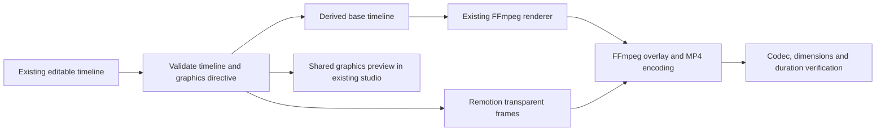

# Remotion + FFmpeg integration: local evaluation

Status: local rendering and browser evaluation passed. Commercial Remotion use is disabled. No commit, push, deployment, production SQL or paid API activation.

## Licensing decision

The owner confirmed COBS has four or more employees. Remotion is source-available under its own licence, not unrestricted open-source software. Its published licence permits non-commercial evaluation; ordinary commercial company use requires an appropriate company licence. This work uses synthetic test media only and has not purchased or activated a licence.

As checked on 16 October 2026, Remotion lists Automators at $0.01/render with a $100/month minimum, and Creators at $25/seat/month for low-volume manual/local creation. This automated editor likely fits Automators; that is an inference, and the vendor should confirm the correct category before any purchase. See [official licence](https://github.com/remotion-dev/remotion/blob/main/LICENSE.md) and [pricing](https://www.remotion.dev/docs/license/pricing). The existing FFmpeg-only editor remains the free operating path.

## Architecture and exact division of responsibility

| Component | Responsibility | This milestone |
| --- | --- | --- |
| Existing editable timeline / Automatic Editing Director | Media IDs, scene order, durations, trims, captions, presets and owner review | Preserved; one timeline |
| FFmpeg base renderer | Video trimming/speed, photographs, warm grading, zoom/pan, picture-in-picture, captions, transitions and audio mixing | Existing implementation reused unchanged |
| Remotion | React animated titles, accent-line reveal and original-logo fade/scale closing treatment | Real transparent PNG frame rendering, two supported title styles |
| FFmpeg final pass | Composite transparent graphics over the base; encode H.264; copy existing AAC audio | Real playable MP4 |
| Shared graphics component | Exact same frame-based SVG layout for evaluation preview and Remotion frames | Reused in the existing editor behind an evaluation-only flag |
| Production job queue / API | Owner-only private FFmpeg exports | Unchanged; does not accept or run the new Remotion evaluator |

No duplicate media database, editing system or production queue was introduced. The derived base suppresses only the titles/closing watermark supplied by the graphics layer, preventing duplication. It does not overwrite the source timeline or originals. Standard app exports remain FFmpeg-only.

## Installation and compatibility

Pinned development/evaluation dependencies: `remotion`, `@remotion/bundler` and `@remotion/renderer` at **4.0.536**. Added React DOM TypeScript declarations. Their React peer range accepts the existing React 19 installation. Node 22.23.3 and the existing Windows Chrome/FFmpeg binaries are used; no cloud renderer or additional hosted project was created. The installation audit reported zero vulnerabilities.

Remotion packages must remain on identical exact versions: [official bundler guidance](https://www.remotion.dev/docs/bundler). The adapter uses [renderFrames](https://www.remotion.dev/docs/renderer/render-frames) and transparent PNGs, then the existing FFmpeg binary. It never passes an API/licence key, signed URL or environment credential into the composition. Remotion's documented server-side telemetry is conditional on a supplied licence key; no key was supplied and no browser-side renderer was installed. See [telemetry documentation](https://www.remotion.dev/docs/telemetry).

The evaluator is a development tool, not a deployable production feature. A future licensed worker would need its runtime dependencies installed explicitly, Chrome/FFmpeg, filesystem access, bounded CPU/memory/disk and the existing job ownership/lease controls. No Vercel deployment changes were made.

## Supported and unsupported instructions

`compileGraphicsPlan` accepts data only: an explicit local-evaluation mode, version, known clip IDs, titles of at most 80 characters, `premium-title` or `lower-third`, and a bounded final original-logo request. It derives frame windows from the existing timeline, including transition overlaps. Unknown fields, styles, foreign clip IDs, duplicate scenes and unsupported commercial mode are rejected. Generated JSX, shell commands, arbitrary asset URLs and code execution are not supported.

`directiveFromTimeline` maps the existing rule-based director's editable scene titles and ending settings. No live AI calls or visual scene analysis occur. Text is not silently shortened; overlong titles fail validation. Existing trims, colour, source speed, zoom/pan and transitions remain FFmpeg operations. Arbitrary Remotion shaders, unrestricted keyframes and new transition types were not added.

The initial hybrid evaluator is capped at **15 seconds, 25 fps, concurrency 1**. It validates the base and finished file against the plan (dimensions, duration, H.264/AAC and size). A graphics-render deadline cancels stalled frame rendering. Existing standard export limits remain unchanged.

## Existing interface

Manual Editing and Create with AI remain intact. Evaluation graphics are shown only when the local test process explicitly sets `NEXT_PUBLIC_COBS_REMOTION_EVALUATION=1`; it is unset in normal operation. The owner-only studio disclosure explicitly states that this is non-commercial evaluation and that standard exports do not include this layer. No environment file was modified.

Graphics preview and export use the same SVG/frame component. The base footage preview still has the existing approximate colour/transition/audio limitations; the completed MP4 remains authoritative for the whole composition. This distinction is visible and is not presented as full live compositing parity.

## Reproduce the synthetic evaluation

From the repository using its portable Node on PATH, run `npm.cmd run media:remotion:evaluate`. This runs a local test harness that creates exactly three synthetic video files and three synthetic PNGs in the ignored `.tools/remotion-evaluation` directory, renders an FFmpeg base and Remotion graphics, then verifies and copies the final sample to `.tools/delivery/media-studio/cobs-remotion-evaluation.mp4`.

The footage is labelled synthetic masonry test patterns, not real construction work. Audio is synthetic test tones, not professional/licensed music. Titles make no claims about company projects, customers, prices or outcomes. No production records or company media are uploaded or removed.

## Recovery and preserved work

Before integration, 152 files were checkpointed and hash-verified at `.tools/checkpoints/remotion-2026-10-16T15-52-12-255Z`. This includes the earlier uncommitted UX/cinematic work. Restore only individually reviewed integration files from that checkpoint; never reset the working tree or alter database history. Evaluation outputs are ignored local files.

Supabase auth/RLS, P1, owner approval, Media Library, original logo file, existing presets and the production FFmpeg worker/API remain unchanged by this integration. P2 and all production migration/security changes remain pending.

## Actual results

The full automated suite passed: **165 tests in 32 files**. Subsequent caption-preservation changes passed all six affected tests in three files, including another real render. The complete browser run passed 12 scenarios and exposed one evaluation-test setup issue: a captions-only plan correctly disabled an empty graphics preview. The test now supplies an explicit editable title. Its rerun passed; the final affected browser run passed all three scenarios (studio, login and hybrid playback). Thus 13 distinct scenarios have passing evidence, rather than claiming one uninterrupted green full browser run.

The actual output is an **11-second, 720 × 1280, 25 fps H.264/AAC MP4**, 275 frames and 582,389 bytes. Chrome played it to completion. All six intended source segments were verified in order, with source trim markers, transition pixels, animated title pixels, nonzero audio in every scene and unchanged original source hashes. The shared SVG preview and rendered graphics frame had mean RGBA error **0** on this Chrome setup. Closing-caption comparison had mean channel error **1.83**, with 1,849 bright caption pixels; the closing treatment was corrected to preserve native caption visibility. The original logo crop had mean channel error **1.69** against the original image resized for comparison; the source JPEG itself remains unchanged.

Local evidence is ignored rather than committed: [sample MP4](.tools/delivery/media-studio/cobs-remotion-evaluation.mp4), [contact sheet](.tools/delivery/media-studio/remotion-contact-sheet.png), [render measurements](.tools/delivery/media-studio/remotion-evaluation-verification.json) and [browser measurements](.tools/delivery/media-studio/remotion-browser-verification.json).

Measured base rendering took **9.43 seconds**, followed by **51.00 seconds** for the hybrid stage: bundling 11.01 seconds, graphics 27.63 seconds and final encoding 7.92 seconds (other overhead accounts for the remainder). Total approximately **60.43 seconds**. Graphics scratch PNGs occupied 10,457,595 bytes. Peak measured parent Node RSS was 581,152,768 bytes (about 554 MiB); parent CPU time was 6.49 seconds. These measurements exclude child Chrome/FFmpeg memory and CPU and are not production capacity estimates.

Security/API and application checks use existing mocks or local fixtures. No hosted Supabase verification, live AI call or commercial Remotion operation is claimed. Final TypeScript, formatting and production-build status is recorded in the delivery update below.

## Remaining approval boundaries

### Final delivery checks

Final sequential checks passed on 16 October 2026: `npm.cmd run typecheck`, `npm.cmd run format:check` and `npm.cmd run build` (Next.js 15.5.28, seven generated pages; Home first-load JavaScript 221 kB). The build emitted Node's existing experimental SQLite warning without failing. `git diff --check` passed. A heuristic scan of 69 candidate source/documentation files found no credential indicators; local VS Code configuration and ignored browser/render/recovery artifacts are excluded from deliverable source. This scan is not a guarantee against every possible secret format.

All 37 protected files checked against the pre-integration checkpoint are unchanged, including the production worker/API/security files and original logo. Core Next/React/Supabase/TypeScript/Vitest versions remain unchanged. The working branch is `develop/dashboard-media`; HEAD remains `a9e53f54a3b2de9f9c84e8bc4e726393eb2b158f`, and local main remains `5578dfdbebc4029f028dbdfed4da692146c84e5e`. Nothing was committed or pushed.

The refreshed ordinary local application is running at `http://127.0.0.1:3102`, with evaluation mode unset and live OpenAI generation disabled for this preview process. Read-only smoke checks returned 200 for Home and the original JPEG, and 401 for the unauthenticated Studio API. No environment file or hosted configuration was changed; this smoke check does not establish live owner authentication or worker readiness.

Commercial Remotion use is blocked pending licensing choice and separate approval. If cost is unsuitable, retain the existing FFmpeg-only path and implement future graphics with free components. A licensed production integration would require a separate reviewed change to the existing job protocol, readiness, limits, cancellation and security tests; no new queue or database is needed. Advanced cloud timeline persistence and previous security/migration-history issues retain their existing documented boundaries.

## Hosting, CPU and memory assessment

The evaluation ran on Windows with Node 22.23.3, an Intel Core i5-7300HQ (four logical CPUs) and approximately 8 GB installed RAM. Remotion frame concurrency and final FFmpeg encoding are bounded to one in this prototype. It uses the installed Chrome executable and local FFmpeg/ffprobe, not a paid remote renderer.

Budget a dedicated persistent worker with approximately four CPU cores and 8 GB RAM as a starting test configuration, writable scratch disk and pinned fonts/browser versions. This is an engineering recommendation based on the test host, not a verified minimum or production sizing guarantee. Node RSS/CPU measurements exclude Chrome and FFmpeg children; aggregate peak RAM/CPU remains unmeasured. Native source decoding, 1080p/4K footage and concurrent jobs need separate benchmarks before hosting approval.

The sample uses only about 133 KB of compressed synthetic originals and is not representative of real construction footage. PNG scratch space is measured separately; bundler cache and browser files require additional storage. Cold bundling added substantial startup time in the exploratory run. Do not extrapolate the observed cached throughput into a production SLA.

No serverless/container/hosting deployment was attempted. A later licensed integration should reuse the current durable job queue, add capability/readiness negotiation and cancellation, and cache an immutable composition bundle. The existing frontend need not be replaced or coupled to a new video editor.

## Limitations and approval needed

- Commercial Remotion rendering for this company is not enabled. Licence category/cost and activation need separate owner approval.
- The hybrid renderer is an isolated local evaluation tool; there is no production Remotion export endpoint, worker lease integration or cloud persistence for graphics directives yet.
- The app's standard Export combined MP4 button intentionally continues to use the existing FFmpeg renderer. Enabling an evaluation preview does not silently change that export.
- Graphics-layer preview/export parity is tested on this Windows/Chrome/font setup. Full live footage compositing parity and Linux/font parity are not claimed.
- The actual hybrid sample is portrait. Other existing aspect ratios derive valid layout dimensions, but hybrid exports in those ratios are not yet rendered acceptance tests.
- No visual scene understanding, beat detection, arbitrary motion-graphics code, paid AI generation or copyrighted music is supplied.
- Existing advanced cloud timeline persistence, external publishing/integration verification, security-advisor warnings, P2 and migration-history reconciliation remain governed by their earlier reports and approval requirements.
